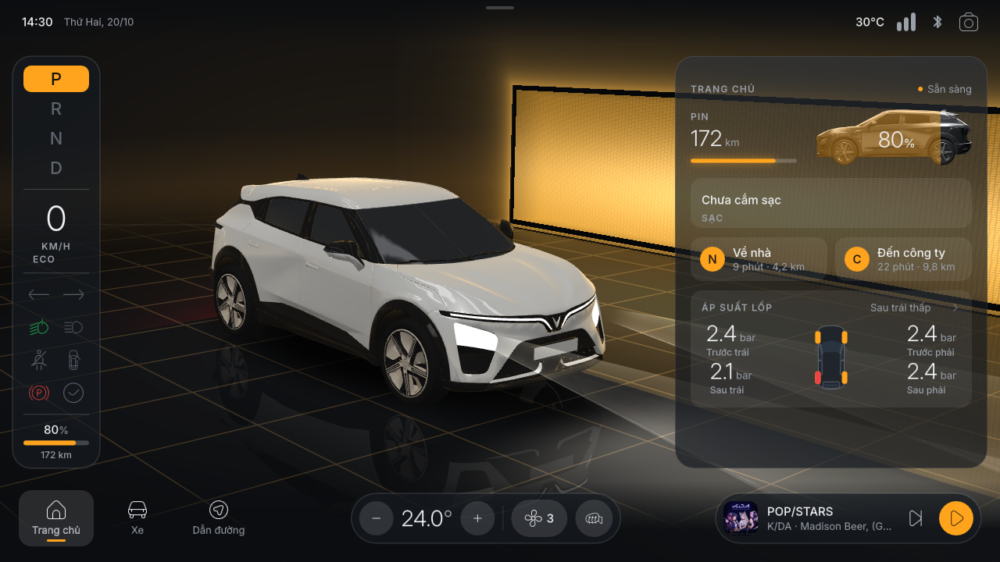

# VF3 HMI Concept

Giao diện màn hình trung tâm (HMI) cho một mẫu xe điện cỡ nhỏ, dựng hoàn toàn bằng [Rive](https://rive.app). Xe 3D được vẽ thời gian thực ngay trong file Rive bằng script Luau và shader WGSL. Ngoài xe 3D, file có giao diện 2D, dữ liệu mẫu và nhạc, tất cả gói trong **một file `.riv`** chạy được trên web.

> Dự án cá nhân, concept phi thương mại. Không liên kết với VinFast. Tên, logo và kiểu dáng xe chỉ dùng để minh họa.



## Điểm nổi bật

- **Xe 3D thời gian thực trong Rive.** Model VF7 khoảng 210k tam giác, đọc từ file GLB và vẽ bằng GPU API của Rive.
  - Có phản chiếu studio, bóng đổ và đèn xe: DRL, pha/cốt có vệt sáng, đèn hậu, xi-nhan.
  - Đổi được 4 màu sơn. Bánh xe quay theo quãng đường đi.
  - Kéo để xoay xe. Mỗi màn có một góc camera riêng, chuyển mượt giữa các màn.
- **Cảnh khởi động.** Xe lăn bánh vào studio, phanh chúi đầu, rồi giao diện hiện dần.
- **5 màn chính:**
  - **Trang chủ:** pin (phủ màu nhấn theo mức sạc), sạc, lối tắt về nhà / đến công ty, áp suất lốp.
  - **Xe:** hình xe vector nhìn từ trên; chạm vào từng cánh cửa hoặc cốp để mở, xe 3D mở theo.
  - **Điều hòa:** camera bay vào khoang lái, luồng gió phát sáng tỏa ra từ cửa gió.
  - **Giải trí:** phát nhạc thật, đèn studio nhảy theo nhạc.
  - **Dẫn đường:** cảnh lái 3D với đường, vạch làn, nhà hai bên và thẻ rẽ.
- **Điều khiển nhanh:** vuốt từ mép trên xuống.
- **Cụm đồng hồ bên trái:** số P R N D, tốc độ, chế độ lái, đèn báo.
- **Giao diện sáng / tối** chuyển mượt. Toàn bộ màu nhấn lấy từ một chỗ.
- **Data binding:** mọi trạng thái nằm trong view model `VF3`, nên app hoặc trang web bên ngoài điều khiển được (xem mục Điều khiển từ JavaScript).

## Nội dung folder

| Đường dẫn | Là gì |
|---|---|
| `index.html` | Trang chạy demo: tự tải `vf3-hmi.riv`, có thanh công cụ (Contain/Layout, Khởi động lại, Toàn màn hình, mở file `.riv` khác) |
| `vf3-hmi.riv` | File Rive đã build và **ký** (bắt buộc với web runtime vì file có script), khoảng 23 MB, gồm cả model 3D, font và nhạc |
| `runtime/` | Rive web runtime `@rive-app/webgl2` 2.45.0 (`rive.js`, `rive.wasm`, giấy phép MIT), để trang không phụ thuộc CDN |
| `screens/` | Ảnh chụp các màn, dùng làm ảnh minh họa trên website (`0_trang_chu.png` là ảnh đại diện) |
| `source/` | Toàn bộ mã nguồn để build lại file `.riv` (xem mục Build lại từ source) |
| `README.md` | Tài liệu này |

## Chạy thử trên máy

Trình duyệt không cho trang mở bằng `file://` tự tải file khác, nên cần một web server tĩnh bất kỳ:

```bash
cd vf3-hmi-showcase
python3 -m http.server 8000
# mở http://localhost:8000
```

Nếu vẫn mở thẳng `index.html` bằng double-click, trang sẽ hiện ô kéo thả: kéo `vf3-hmi.riv` vào là chạy.

## Đưa lên website

1. Upload **nguyên folder** (ít nhất `index.html`, `vf3-hmi.riv`, `runtime/`, `screens/`) lên hosting tĩnh: GitHub Pages, Netlify, Vercel, Cloudflare Pages, hoặc thư mục con trên website hiện có, ví dụ `https://tenmien.com/projects/vf3-hmi/`.
2. Kiểm tra server trả `rive.wasm` với kiểu `application/wasm`. Các hosting kể trên đã cấu hình sẵn. Nếu dùng Apache tự quản, thêm vào `.htaccess`:
   ```
   AddType application/wasm .wasm
   ```
3. File `.riv` khoảng 23 MB, chủ yếu là nhạc và model. Trang có thanh tiến trình khi tải. Nên bật nén gzip/brotli trên server nếu có. GitHub Pages giới hạn 100 MB mỗi file nên vẫn dùng được.

### Nhúng vào một trang khác (iframe)

Thêm `?embed=1` để ẩn thanh công cụ, chỉ còn giao diện:

```html
<div style="aspect-ratio: 16 / 9; width: 100%; max-width: 1280px;">
  <iframe src="/projects/vf3-hmi/index.html?embed=1"
          style="width: 100%; height: 100%; border: 0; border-radius: 16px;"
          allow="fullscreen; autoplay" loading="lazy" title="VF3 HMI Concept"></iframe>
</div>
```

Các tham số URL:

- `?embed=1`: ẩn thanh công cụ.
- `?fit=layout`: giao diện co giãn theo khung thay vì giữ tỉ lệ 16:9. Có thể dùng cùng embed: `?embed=1&fit=layout`.

Lưu ý khi nhúng:

- Phím tắt chỉ hoạt động sau khi người xem bấm vào khung iframe một lần, vì trình duyệt chỉ gửi phím cho phần đang được focus.
- Trình duyệt chặn âm thanh tự phát, nên nhạc chỉ phát được sau khi người xem chạm vào giao diện.

### Yêu cầu trình duyệt

Cần trình duyệt hỗ trợ WebGL 2: Chrome, Edge, Firefox, Safari 15+ bản mới. Trên điện thoại vẫn chạy được, nhưng model 3D khá nặng nên máy yếu sẽ chậm. Thiết kế tối ưu cho màn ngang 16:9 (1280 × 720).

## Cách dùng demo

| Thao tác | Kết quả |
|---|---|
| Chạm thanh điều hướng dưới cùng | Chuyển màn: Trang chủ, Xe, Dẫn đường; Điều hòa và Giải trí ở cụm giữa và bên phải |
| Kéo trên xe 3D | Xoay xe |
| Vuốt từ mép trên xuống | Mở bảng điều khiển nhanh: màu xe, theme sáng/tối, khóa, đèn, độ sáng, âm lượng… |
| Màn Xe: chạm vào cánh cửa / cốp trên hình nhìn từ trên | Mở / đóng cánh đó, xe 3D mở theo |
| Chạm thẻ Sạc ở Trang chủ | Giả lập cắm sạc |
| Chạm một điểm đến ở màn Dẫn đường | Bắt đầu cảnh lái; chuyển số D, tốc độ chạy theo |
| Phím `1` | Về Trang chủ và phát lại cảnh khởi động |
| Phím `2` | Mở / đóng điều khiển nhanh |
| Phím `E` / `N` / `S` | Chế độ lái Eco / Normal / Sport |
| Phím `F` | Toàn màn hình (do `index.html` xử lý) |

## Điều khiển từ JavaScript

File dùng view model `VF3` (instance `SampleData`) và được bind tự động (`autoBind: true`). Trong `index.html`, biến `instance` là đối tượng `rive.Rive`:

```js
const vm = instance.viewModelInstance;
vm.number('section').value = 1;        // 0 Trang chủ, 1 Xe, 2 Điều hòa, 3 Giải trí, 4 Dẫn đường
vm.number('paint').value = 2;          // màu xe: 0 đen, 1 xám, 2 đỏ, 3 trắng (mặc định)
vm.number('doorFL').value = 1;         // mở cửa trước trái (doorFR, doorRL, doorRR, trunk)
vm.number('driveMode').value = 2;      // 0 Eco, 1 Normal, 2 Sport
vm.string('batteryPct').value = '63';  // số % hiển thị
vm.number('batteryFrac').value = 0.63; // 0..1, thanh pin và lớp phủ trên xe
vm.number('chargeState').value = 1;    // đang sạc
```

Danh sách đầy đủ các property nằm trong `source/README.md`, mục **View model `VF3`**.

## Công nghệ và cách dựng

- **Rive CLI + RML.** Toàn bộ scene (artboard, layout, data binding, state machine, listener) được sinh bằng code. Script Python `source/tools/gen.py` ghi ra `source/scene.rml`, sau đó Rive CLI build thành `.riv`. Không kéo thả tay trong editor.
- **Script Luau** chạy trong Rive:
  - `car3d/`: đọc GLB, camera, intro, cửa, đèn.
  - `media/`: trình phát nhạc, đèn theo nhạc.
  - `nav/`: mô phỏng lái.
  - `cluster/`: số và tốc độ.
  - `charge/`: mô phỏng sạc.
  - `quick/`: cử chỉ kéo bảng.
  - `theme/`: chuyển màu sáng/tối.
- **Shader WGSL** (`car3d/car3d_shader.wgsl`):
  - Vật liệu xe, phản chiếu, bóng.
  - Cửa xoay quanh bản lề, bánh xe quay.
  - Đèn và vệt sáng, gió điều hòa, đường và nhà trong cảnh lái.
- **Blender:**
  - Giảm lưới model và tách vật liệu (sơn, kính, đèn, từng cánh cửa, cốp).
  - Render ảnh xe nhìn ngang.
  - Render nhìn từ trên rồi trace bằng potrace thành path vector (`source/assets/topview/`).
- **Âm nhạc:** mức bass/mid/high và nhịp của từng bài được phân tích trước bằng `tools/analyze_music.py` (ffmpeg + numpy), lưu thành file `.lvl` đi kèm, để đèn nhảy theo nhạc.

## Build lại từ source

Cần: [Rive CLI](https://rive.app) 1.7+ (đã `rive login` để ký script), Python 3 có Pillow. Nếu đổi nhạc thì cần thêm ffmpeg và numpy; nếu trace lại hình thì cần potrace.

```bash
cd source
python3 tools/gen.py          # sinh scene.rml
rive . --verify               # kiểm tra
rive .                        # mở previewer (tự build lại mỗi lần lưu)
rive . --publish              # build + ký -> build/vf3-hmi.riv
cp build/vf3-hmi.riv ../vf3-hmi.riv   # thay file mà index.html đang dùng
test/shots.sh                 # chụp lại ảnh các màn
```

Lưu ý:

- **Web runtime từ chối file chưa ký.** File build bằng `rive .` hay `--screenshot` chỉ chạy được trong previewer. Muốn đưa lên web phải dùng `--publish`.
- **Export từ Rive Editor cần bật asset.** Nếu export `.riv` từ Rive Editor thay vì CLI, phải bật **Include in export** cho các asset (model `car`, nhạc, ảnh, font). Nếu không, file xuất ra sẽ không có xe.

## Nguồn và ghi công

- **Rive web runtime:** © Rive, giấy phép MIT (`runtime/LICENSE`).
- **Font Inter:** Rasmus Andersson, SIL Open Font License.
- **Icon:** bộ icon nét mảnh từ Flaticon (Uicons Thin Rounded và gói "Car dashboard outline"). **Icons by Flaticon.** Danh sách link nằm trong `source/tools/icons/SOURCES.txt`.
- **Nhạc trong phần Giải trí:** các bài của K/DA (Riot Games): POP/STARS, THE BADDEST, MORE, VILLAIN, DRUM GO DUM, I'LL SHOW YOU, FIRESTARTER. Bản quyền thuộc chủ sở hữu, chỉ dùng minh họa trong dự án cá nhân phi thương mại.
- **Model 3D:** VF7 dạng đất sét, được giảm lưới và chỉnh sửa trong Blender. Nguồn model gốc: _(điền nguồn và giấy phép của model gốc)_.
- **Thiết kế và phát triển:** _(tên bạn / link)_.
